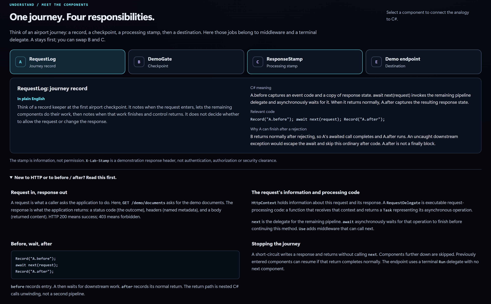
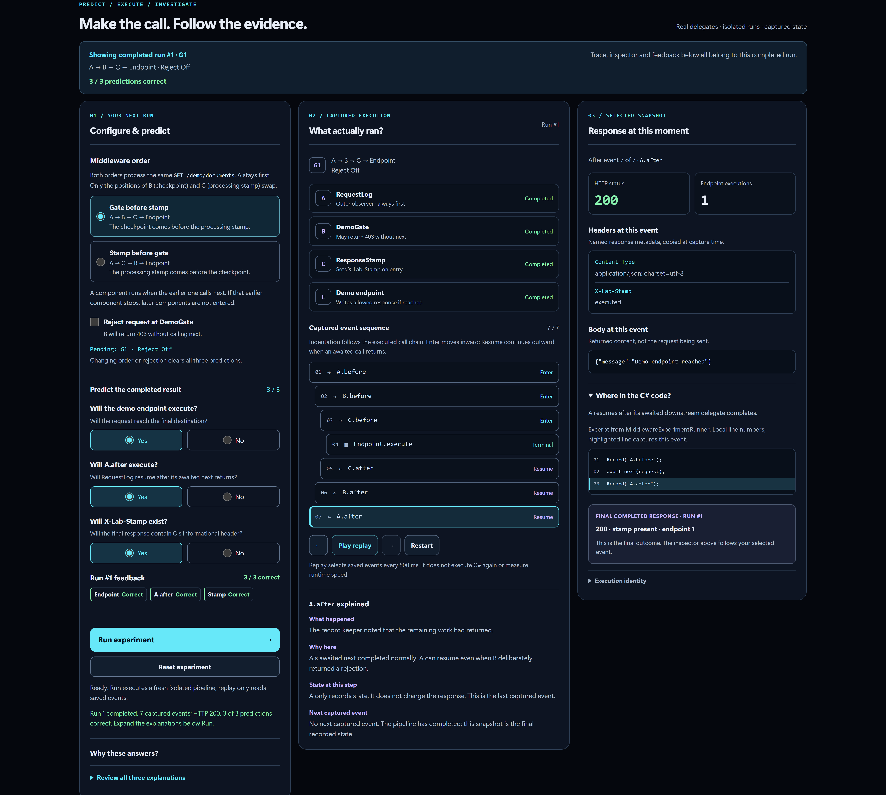
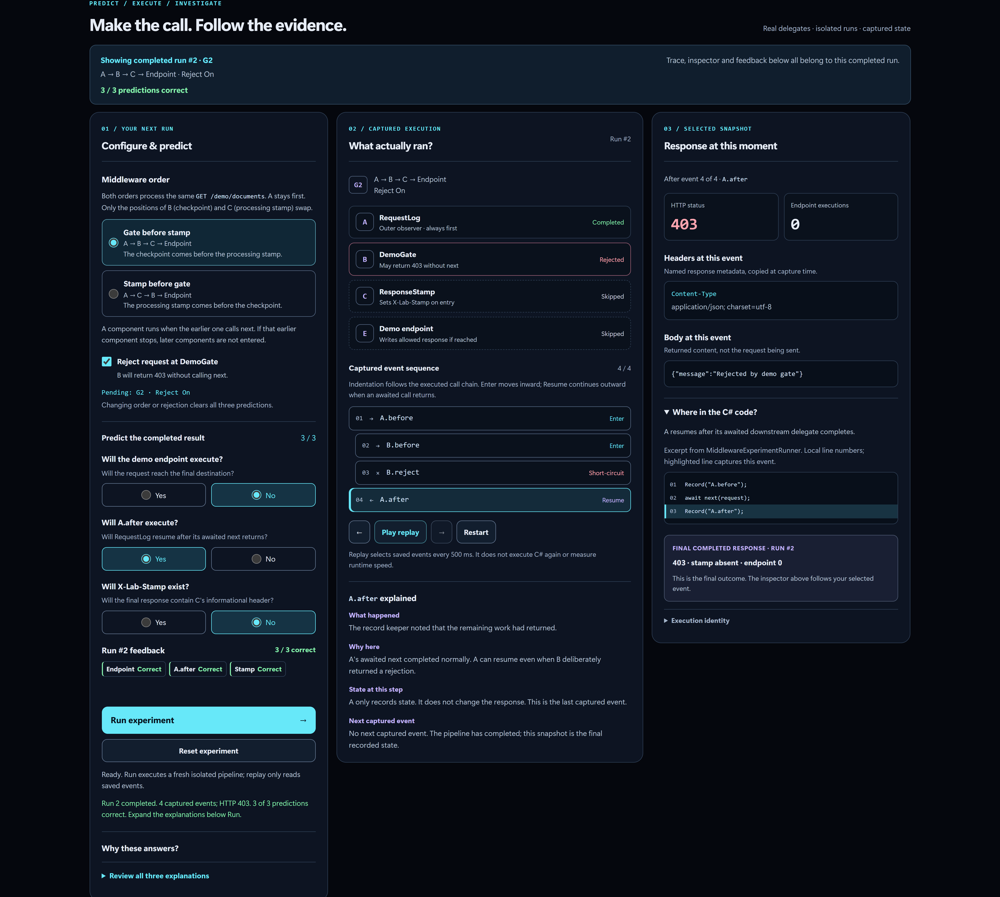
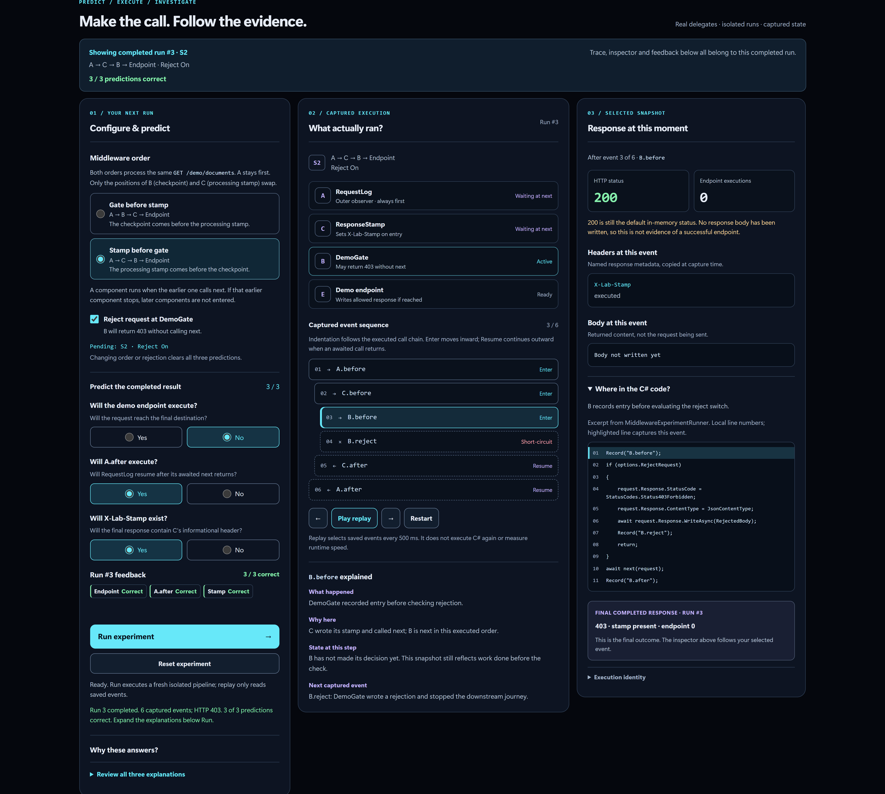
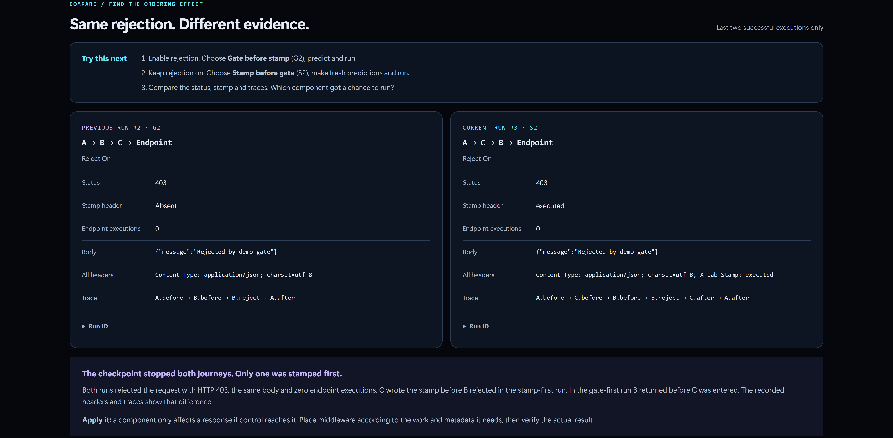
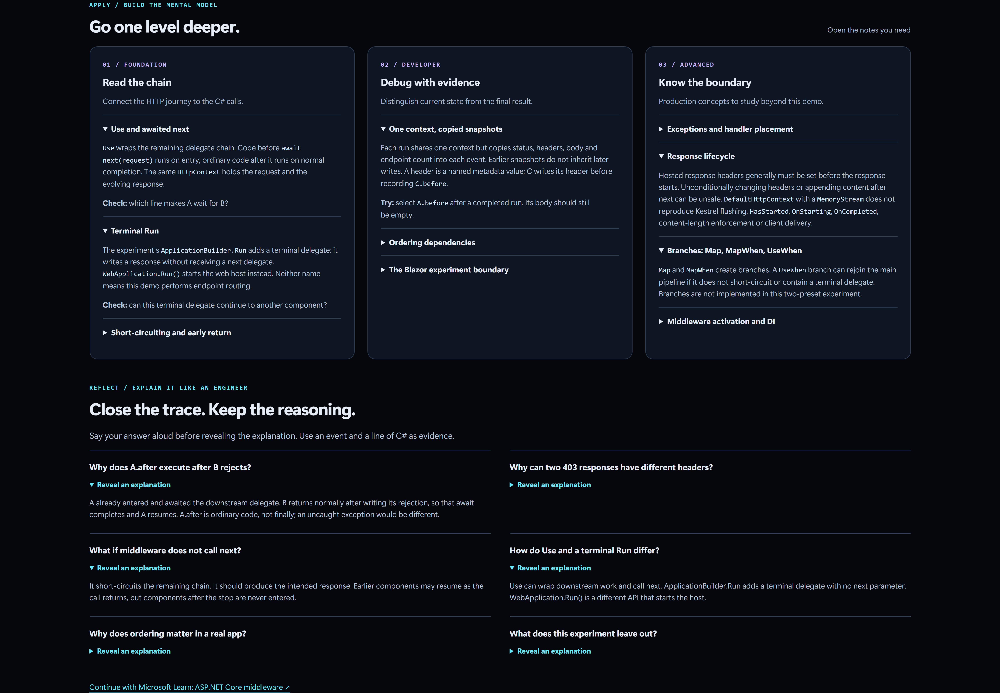

# Lab 03: Middleware Flight Recorder

**Follow the request. Explain the return.**

Lab 03 is an interactive ASP.NET Core learning experience in the [DotNetScope](https://github.com/sarosh-jawed/dotnet-visual-lab) repository. It uses a small, real in-memory middleware pipeline to show how requests enter, how control returns, and why component order changes the final response.


## What you will learn

- How ASP.NET Core middleware calls the next delegate and resumes after that delegate completes.
- Why `A.after` still executes after an ordinary downstream rejection, but not necessarily after an uncaught exception.
- How a middleware component can short-circuit the pipeline without reaching the terminal endpoint.
- Why moving a header-writing component before a rejecting component changes the headers on the completed response.
- How to distinguish an intermediate response snapshot from the final HTTP response.

## One request, four responsibilities

The lab uses an airport journey analogy, then connects each role to the corresponding C# behavior.

| Component | Role | What it does |
| --- | --- | --- |
| **A: RequestLog** | Journey record | Captures `A.before`, calls the remaining pipeline, then captures `A.after` when that call completes normally. |
| **B: DemoGate** | Checkpoint | Allows the request to continue or writes an HTTP 403 response and stops further processing. |
| **C: ResponseStamp** | Processing stamp | Writes the informational `X-Lab-Stamp` response header when execution reaches it. |
| **E: Demo endpoint** | Destination | Writes the success response if the request reaches the terminal delegate. |

`X-Lab-Stamp` is demonstration metadata, not a security credential or authorization check.



## The experiments

Choose a middleware order, decide whether DemoGate rejects the request, and predict three results: endpoint execution, `A.after` execution, and stamp-header presence. Then run the real pipeline and inspect the recorded evidence.

| Preset | Component order | Reject? | Final status | Stamp header | Endpoint executions |
| --- | --- | --- | --- | --- | --- |
| G1 | A, B, C, endpoint | No | 200 | Present | 1 |
| G2 | A, B, C, endpoint | Yes | 403 | Absent | 0 |
| S1 | A, C, B, endpoint | No | 200 | Present | 1 |
| S2 | A, C, B, endpoint | Yes | 403 | Present | 0 |

The most revealing pair is **G2 versus S2**. Both end with HTTP 403, but only S2 contains the stamp. In G2, B rejects before C runs. In S2, C sets the header before B rejects.

### Successful request: G1



### Rejected request: G2



### Rejected request with stamp: S2



### Compare two completed runs

The comparison view preserves the last two completed runs. Use it to examine response status, headers, body, endpoint count, and the actual event sequence without rerunning earlier experiments.



## From beginner concepts to engineering reasoning

The lab includes progressively deeper notes on delegate calls, response snapshots, pipeline order, exception boundaries, and middleware activation. Reflection questions encourage explaining each result using a captured event and the corresponding C# code.



## Run locally

Requirements: .NET 10 SDK and the repository's pinned SDK configuration in `global.json`.

From the repository root, run:

```powershell
dotnet restore DotNetVisualLab.slnx
dotnet build DotNetVisualLab.slnx --configuration Release
dotnet test DotNetVisualLab.slnx --configuration Release --no-build
dotnet run --project src/DotNetVisualLab.Web/DotNetVisualLab.Web.csproj --configuration Release --no-build --launch-profile https
```

Open the local URL shown in the console, then navigate to `/middleware`.

## Technical boundary

This lab builds an isolated ASP.NET Core pipeline using real delegates, a synthetic `DefaultHttpContext`, and an in-memory response stream. It captures response state at each recorded event. Replay visits the saved snapshots; it does not execute another request. The demonstration does not model the site's normal routing, a browser-to-Kestrel request, production authentication, transport flushing, or distributed tracing.

## Verification

The October 16, 2026 local run reported a successful Release build, **6 passing middleware-focused tests**, and **19 passing tests across the solution**. Final browser behavior was reviewed for G1, G2, S1, S2, run comparison, event stepping, and feedback. This is not a claim of exhaustive production-browser or screen-reader certification.

## Related learning

- [Microsoft Learn: ASP.NET Core middleware](https://learn.microsoft.com/en-us/aspnet/core/fundamentals/middleware/?view=aspnetcore-10.0)
- [DotNetScope repository](https://github.com/sarosh-jawed/dotnet-visual-lab)

**Built by Sarosh Jawed** as part of a hands-on .NET learning series.
